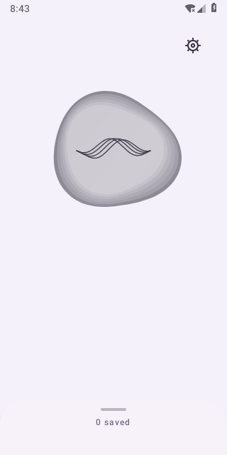
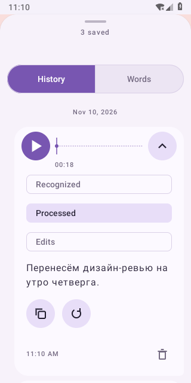
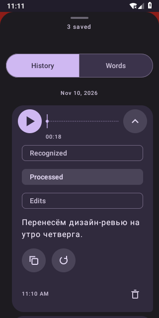
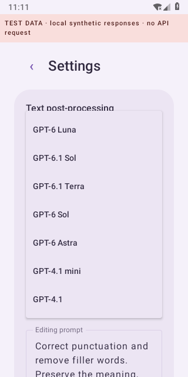

# Android Voice Dictation

Record speech on Android, transcribe it with your own OpenAI API key, and optionally edit the recognised text with a second model and your prompt. Use the same organic dictation control in the app and beside the keyboard in other apps.

Android **8.0+ (API 26)** for recording, history and in-app transcription. Automatic insertion from the optional floating control requires **Android 13+ (API 33)** and a supported focused text editor. Kotlin, Jetpack Compose and Material 3; English and Russian interface; adaptive phone/foldable history layout.

## What it does

- A tap starts local recording immediately. Stop ends the microphone capture and makes one file-transcription request when a usable key is available.
- Audio, recognised text and optional processed text stay in a shared history. Play and seek through saved audio, copy either text version, or explicitly retry/reprocess. Retrying history never inserts into an old field.
- Optional text post-processing uses a model dropdown and editable prompt in settings. It is a separate request and can incur additional API charges. The original text is saved first; a second-stage failure keeps it recoverable.
- The floating control uses the same tap/hold interaction. It inserts at most once into the original eligible editor, otherwise text remains available for Copy. It does not press Send or replace an entire field.
- Vocabulary terms accompany explicit transcription requests. Manually exported diagnostic ZIPs contain fixed event codes, not dictated text or credentials.

There is no live audio streaming mode, automatic network retry, developer-operated transcription server or bundled API key. Offline use covers recording, stored audio/text and playback, **not offline speech recognition**.

## Screenshots

Real 0.19.2 app captures. Main dictation was captured on API 28 from the accepted signed build; history and settings were recaptured on API 28 with synthetic local test data/responses on 2026-11-10. They do not demonstrate a paid API request or universal cross-app compatibility.

| Dictation | History |
| --- | --- |
|  |  |
|  |  |

## Install and start

No tagged GitHub Release is published at this preparation snapshot. [Releases](https://github.com/IlyasYOY/android-voice-dictation/releases) is the future maintainer distribution location; do not assume an APK is available there yet. CI debug APKs and the separate fixture are development artifacts, not verified maintainer releases. To build locally, see below. Maintainers use [manual release preparation](docs/manual-release.md); the [signed release worker](docs/signed-releases.md) is prepared but disabled until owner setup and acceptance.

Maintainer: [IlyasYOY](https://github.com/IlyasYOY). The owner chose to create a new release identity locally; see [the Mac key script and reinstall/data-loss precautions](docs/signing-key.md). This preparation does not change an installed app's certificate or guarantee a developer-name display in Android.

When a reviewed APK is provided:

1. Check its source/version, SHA-256 and signing certificate against the maintainer's verification information. Install only the app APK, not the test fixture. Android may require you to allow installation from the browser/file manager you chose.
2. For an update, install over the existing app with the same signing identity; do not uninstall first if you want to retain app-private data. A build signed with another developer's key cannot update your current installation. The existing sideload identity has a legacy Android Debug subject; a Play Store signing/migration plan is not configured.
3. On first launch, save your own OpenAI API key, or choose **Not now** to record offline. Grant microphone access when recording. The key is encrypted locally; it is not supplied by this repository.
4. Tap the blob to record; tap again to stop. Hold it for the existing contextual actions, including cancellation. Open history to play/copy/retry; use settings for vocabulary, text processing, billing and diagnostic export.
5. To use the floating control, complete its disclosure/setup and explicitly enable Accessibility plus the required recording/notification permissions. It appears beside the visible keyboard for eligible fields. Revoke its Accessibility access in Android settings when no longer wanted.

## OpenAI API and local data

File transcription uses [`gpt-transcribe`](https://developers.openai.com/api/docs/models/gpt-transcribe) at `/v1/audio/transcriptions`, sending the M4A file and saved vocabulary terms. Optional post-processing uses `/v1/responses`, the original transcript and editing prompt, with `store:false`; its default text model is [`gpt-6-luna`](https://developers.openai.com/api/docs/models/gpt-6-luna). Model refresh is an explicit `/v1/models` request, filtered to the app's known text choices. Model access and quota depend on your API account; a selection is not silently substituted if unavailable.

API usage follows your account's API billing/credits. A ChatGPT subscription alone does not establish this key's available API quota. The Billing button opens the official site externally and does not pass the key in the URL. Review current provider pricing/data controls before sending sensitive material; `store:false` does not guarantee zero provider retention.

Read [PRIVACY.md](PRIVACY.md) for local storage, upload triggers, provider boundaries, Accessibility, clipboard, screenshots, backups and diagnostics. Recordings/text are app-private but are **not separately encrypted by the app**. Saved history remains until explicit deletion; the default count limit is 100 and prompts you rather than silently deleting old items. The API key, history and exported diagnostics have different lifetimes.

## Android and compatibility limits

- Floating insertion is supported only on API 33+ and editors that provide a usable input connection and caret metadata. Older versions and unsupported fields use Copy. Rich editors and OEM keyboards vary; the app's fixtures do not certify every app/device.
- Changing focus/caret, hiding the keyboard, cancellation or locking prevents a later insertion into a new target. Selected text, active keyboard composition, password/numeric/payment and other excluded fields are deliberately restricted.
- The floating overlay requests an awake screen while recording/processing. Manual power-off still works; continued recording/transcription while locked is not guaranteed. OEM service/battery restrictions can still matter.
- Application capture limits are 30 minutes and a guarded 20 MB local file cap; upload validation allows at most 24 MB. These are app limits, not promises about provider quotas or account entitlement.
- Failed/interrupted operations remain recoverable for explicit retry. A request may already have reached the provider when cancelled or timed out; cancellation cannot retract it or guarantee no charge.
- No background clipboard watcher, Send automation or automatic replay of uncertain text insertion is used. Copy still exposes the selected text to Android's clipboard and eligible clipboard consumers.

See [editor compatibility](docs/editor-insertion.md), [floating contract](docs/floating-contract.md), [post-processing](docs/text-postprocessing.md), [history/storage](docs/durable-recordings.md) and [diagnostics](docs/diagnostics.md).

## Build and contribute

Use JDK **17 or 21**, Python **3**, Android API **36**, Build Tools **35.0.0**, and the committed Gradle **8.13** wrapper. Set up an SDK explicitly; do not accept its licenses implicitly. [Pinned versions/checksums](docs/toolchain.md), [SDK/cloud setup](docs/cloud-environment.md) and [CONTRIBUTING.md](CONTRIBUTING.md) describe the prerequisites.

```sh
export ANDROID_HOME=/absolute/path/to/android-sdk
bash scripts/check.sh
```

This builds the app/fixture, runs lint and JVM tests, and compiles Android test APKs. It does not execute instrumentation. With an available test device/emulator, run `./gradlew :app:connectedDebugAndroidTest` and report the actual device/API and results. Automated tests use synthetic transports/data; do not add a personal key or paid provider request to the test setup.

Architecture and safety contracts are in [docs/architecture.md](docs/architecture.md) and [AGENTS.md](AGENTS.md). For vulnerabilities follow [SECURITY.md](SECURITY.md); ordinary issues/PRs must contain no secrets or private dictation. Project code is [MIT licensed](LICENSE); third-party components retain [their own terms and notices](THIRD_PARTY_NOTICES.md).
